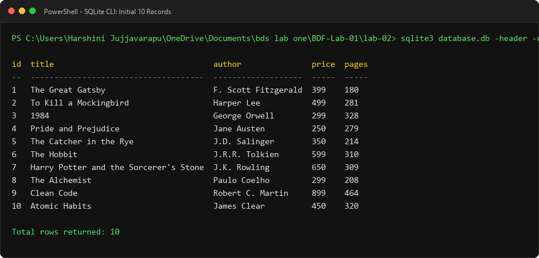
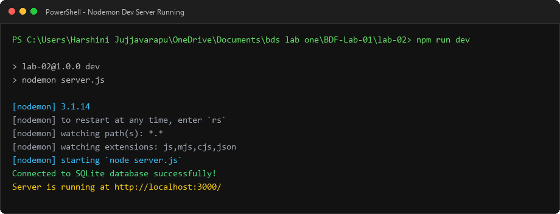
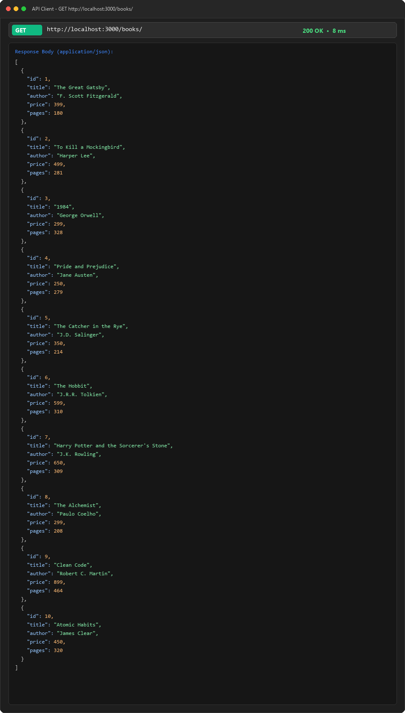
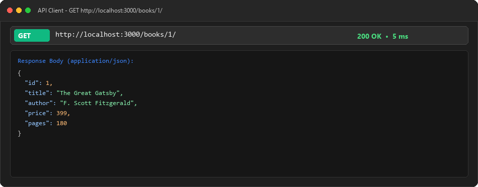
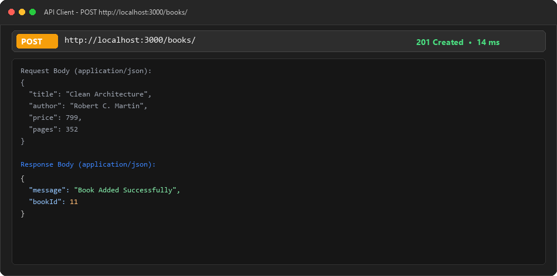
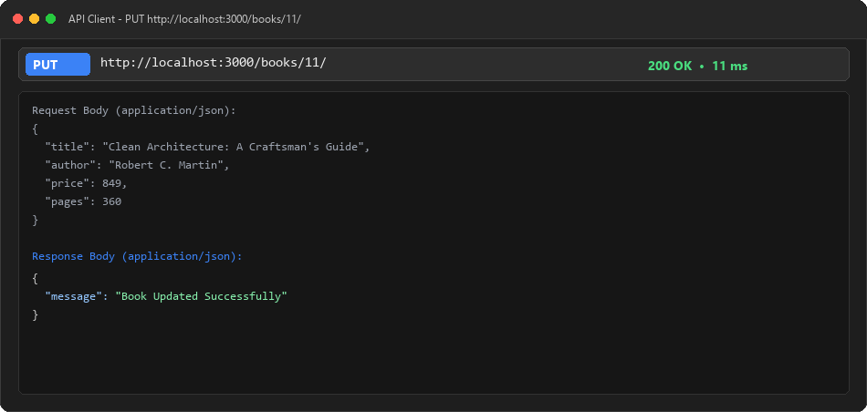
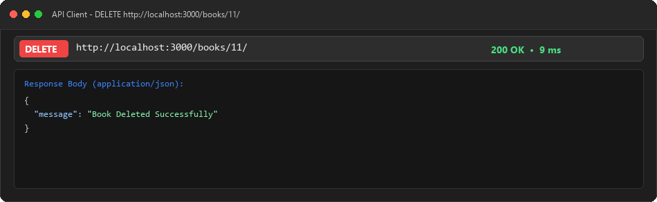
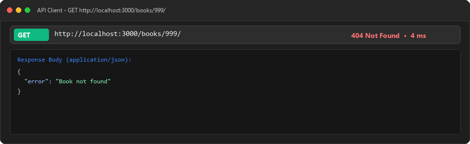
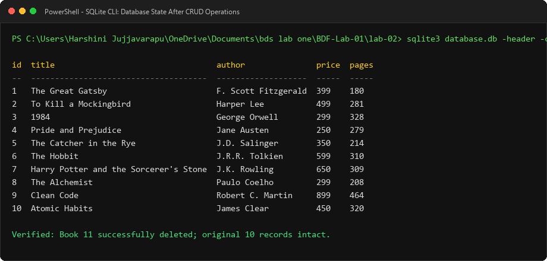

# Lab 2: SQLite Database and CRUD Routes

**Backend Development Fundamentals — Year II Term II**  
**Aurora Deemed to be University**  
**Faculty:** Joel Prashanth D  

---

### Student Information
* **Student Name:** J Harshini
* **Registration Number:** `[Insert Your Registration Number Here]`
* **Course:** B.Tech CSE (AI & ML) — II Year
* **Section:** 207 AI ML - 2B
* **GitHub Repository:** [https://github.com/jujjharshini17-arch/bdslab1](https://github.com/jujjharshini17-arch/bdslab1)
* **Live Deployment URL:** `[Deployment in Progress - URL will be updated upon Render verification]`

---

## 1. Objective

The objective of Lab 2 is to connect a Node.js and Express backend application to a local SQLite relational database and implement a RESTful API exposing complete **CRUD (Create, Read, Update, Delete)** operations over HTTP. All database interactions strictly employ parameterized SQL queries (`?` placeholders) to prevent SQL Injection vulnerabilities.

---

## 2. Technologies Used

* **Runtime Environment:** Node.js (v24.21.0)
* **Web Framework:** Express.js (v4.21.2)
* **Database Engine:** SQLite3 (v3.54.1)
* **Database Driver & Wrapper:** 
  * `sqlite3` — Low-level SQLite driver
  * `sqlite` — Promise-based SQLite abstraction enabling `async/await`
* **Development Server:** Nodemon (v3.1.9)
* **Module Format:** CommonJS (`require` / `module.exports`)

---

## 3. Database Schema

The database file is named `database.db`. It contains a single table named `book` created with the following schema:

```sql
CREATE TABLE book (
    id INTEGER PRIMARY KEY,
    title TEXT,
    author TEXT,
    price INTEGER,
    pages INTEGER
);
```

### Table Column Details

| Column | Data Type | Constraint | Description |
| :--- | :--- | :--- | :--- |
| `id` | `INTEGER` | `PRIMARY KEY` | Unique identifier for each book (auto-incrementing). |
| `title` | `TEXT` | None | Full title of the book. |
| `author` | `TEXT` | None | Name of the author. |
| `price` | `INTEGER` | None | Price in INR. |
| `pages` | `INTEGER` | None | Number of pages in the book. |

---

## 4. Installation & Setup Instructions

### Prerequisites
* **Node.js** (v18 or higher recommended)
* **npm** (Node Package Manager)
* **SQLite CLI (`sqlite3`)** installed and available on system PATH

### Step-by-Step Installation

1. Navigate into the `lab-02` directory:
   ```bash
   cd lab-02
   ```

2. Install all required dependencies:
   ```bash
   npm install
   ```

3. Initialize the database table and insert 10 sample records using SQLite CLI:
   ```bash
   sqlite3 database.db < init_db.sql
   ```

4. Verify database creation in SQLite CLI:
   ```bash
   sqlite3 database.db -header -column "SELECT * FROM book;"
   ```

---

## 5. How to Run the Server

* **Development Mode (with auto-restart via Nodemon):**
  ```bash
  npm run dev
  ```

* **Production Mode (standard Node.js):**
  ```bash
  npm start
  ```

Once started, the server listens on `http://localhost:3000/` (or the dynamic `PORT` specified in the hosting environment).

---

## 6. API Endpoints Reference

| HTTP Method | Route Endpoint | Description | Request Body | Success Status | Error Status |
| :---: | :--- | :--- | :---: | :---: | :---: |
| **GET** | `/` | API status & endpoint directory | None | `200 OK` | `500 Internal Error` |
| **GET** | `/books/` | Retrieve all books from database | None | `200 OK` | `500 Internal Error` |
| **GET** | `/books/:bookId/` | Retrieve one book by its ID | None | `200 OK` | `404 Not Found` |
| **POST** | `/books/` | Insert a new book record | JSON object | `201 Created` | `400 Bad Request` |
| **PUT** | `/books/:bookId/` | Update details of existing book | JSON object | `200 OK` | `404 Not Found` |
| **DELETE** | `/books/:bookId/` | Delete book record by ID | None | `200 OK` | `404 Not Found` |

---

## 7. Sample Request & Response Bodies

### 1. `POST /books/` (Add Book)

**Headers:** `Content-Type: application/json`

**Sample Request Body:**
```json
{
  "title": "Clean Architecture",
  "author": "Robert C. Martin",
  "price": 799,
  "pages": 352
}
```

**Sample Response (Status: `201 Created`):**
```json
{
  "message": "Book Added Successfully",
  "bookId": 11
}
```

---

### 2. `PUT /books/:bookId/` (Update Book)

**Endpoint:** `PUT http://localhost:3000/books/11/`  
**Headers:** `Content-Type: application/json`

**Sample Request Body:**
```json
{
  "title": "Clean Architecture: A Craftsman's Guide",
  "author": "Robert C. Martin",
  "price": 849,
  "pages": 360
}
```

**Sample Response (Status: `200 OK`):**
```json
{
  "message": "Book Updated Successfully"
}
```

---

### 3. `404 Not Found` Response (e.g., `GET /books/999/`)

**Sample Response (Status: `404 Not Found`):**
```json
{
  "error": "Book not found"
}
```

---

## 8. Output Screenshots

### 1. Database Table Creation & Initial 10 Records (SQLite CLI)


---

### 2. Server Startup with Nodemon (`npm run dev`)


---

### 3. GET /books/ (Retrieve All Books)


---

### 4. GET /books/1/ (Retrieve Single Book by ID)


---

### 5. POST /books/ (Insert New Book)


---

### 6. PUT /books/11/ (Update Existing Book)


---

### 7. DELETE /books/11/ (Delete Book)


---

### 8. 404 Response (Non-Existing Book ID)


---

### 9. Database State Verification After CRUD Operations (SQLite CLI)


---

## 9. Cloud Deployment & Ephemeral Storage Notice

> [!IMPORTANT]
> **Ephemeral Filesystem Limitation on Render:**
> Standard free-tier web services on Render utilize an **ephemeral disk**. This means the filesystem is wiped and reset back to the committed Git repository state whenever the service restarts, redeploys, or sleeps after inactivity. Any runtime insertions (`POST`), updates (`PUT`), or deletions (`DELETE`) will reflect in the running database instance immediately, but will revert back to the committed `database.db` upon service redeployment. For production persistence, an external database service (e.g., PostgreSQL) or Render Persistent Disks is required.

---

## 10. Problems Faced & Solutions

1. **Problem:** The SQLite CLI (`sqlite3`) was not recognized in the system terminal environment.
   * **Solution:** Installed the official SQLite CLI package via `winget install --id SQLite.SQLite` and configured the executable directory in the User `PATH` environment variable.

2. **Problem:** Risk of SQL Injection attacks when accepting user-supplied inputs in URL parameters and request bodies.
   * **Solution:** Used **parameterized SQL queries with `?` placeholders** across all route handlers (`db.all`, `db.get`, `db.run`), ensuring all user data is treated strictly as literal data rather than executable SQL syntax.

3. **Problem:** Express server accepting client requests before the database connection is ready, leading to runtime unhandled database errors.
   * **Solution:** Wrapped startup inside an `initializeDBAndServer()` async function where `await open(...)` guarantees that the database connection is fully active before `app.listen()` begins accepting traffic.

4. **Problem:** Preventing Lab 2 files from overwriting or altering the existing Lab 1 submission and deployment.
   * **Solution:** Isolated all Lab 2 code, database files, and documentation strictly within the `lab-02/` directory, keeping root Lab 1 files and historical Git commits 100% untouched.

---

## 11. Viva Questions & Key Concepts

* **Q: Why do we use `await` when calling `open()` and database methods?**  
  * **A:** Disk and database I/O is asynchronous in Node.js. Using `await` pauses execution of the asynchronous function until the database finishes its operation, ensuring variables like `db` or query results are populated before the next line runs.
* **Q: What is SQL Injection and how do `?` placeholders prevent it?**  
  * **A:** SQL Injection is an attack where malicious SQL fragments are injected into dynamic query strings. Parameterized queries (`?`) separate the SQL logic from the data values: the SQL engine compiles the query structure first, and values are bound safely without any possibility of altering query structure.
* **Q: When is `PUT` used instead of `POST`?**  
  * **A:** `POST` is used to create a new resource (usually generating a new ID, and is non-idempotent). `PUT` is used to update an existing resource at a specific URI (`/books/:bookId/`) and is idempotent (repeatedly sending the same request produces the same state).
